<!-- Cards live in assets/ and are generated by scripts/build.py. Edit the copy in scripts/cards.py, not the SVGs. -->

<a href="https://www.joshibhuwan.com.np/">
  <picture>
    <source media="(max-width: 640px)" srcset="./assets/hero-mobile.svg">
    
  </picture>
</a>

<p align="center">
  <a href="#experience"><kbd># experience</kbd></a>
  <a href="#open-source"><kbd># open-source</kbd></a>
  <a href="#shipped"><kbd># shipped</kbd></a>
  <a href="#stack"><kbd># stack</kbd></a>
  <a href="#activity"><kbd># activity</kbd></a>
  <a href="#contact"><kbd># contact</kbd></a>
</p>

I build end-to-end products across web, mobile and 3D. Right now that means 3D signing avatars for [SETU](https://setu.prateekinnovations.com) at Prateek Innovations and a campus booking app at RAIN, plus open-source tools for the Linux desktop in my own time. Based in Kathmandu, studying Computer Science with AI at Sunway College.

<a id="experience"></a>

### `#` experience

<picture>
  <source media="(max-width: 640px)" srcset="./assets/experience-mobile.svg">
  
</picture>

<details>
<summary><b>Plain-text version</b> <sub>for recruiters, search and screen readers</sub></summary>

<br>

**Junior AI Developer, Prateek Innovations** · Jul 2026 to now
Inclusive AI products, 3D systems and interactive 3D for the web. Python, Blender, Three.js, TypeScript, React, Node.js.

**Software Development Intern, Prateek Innovations** · Feb 2026 to Jul 2026
Shipped user-facing web features, backend integrations and API work. Promoted after five months.

**Development Intern, RAIN, Sunway College Kathmandu** · Jan 2026 to now
Building MySunway, a real-time floor and seat booking system, in React Native, TypeScript, Node.js and Firebase.

**IT Head, AIDA**
Worked on the whole [AIDA website](https://aida.prateekinnovations.com) and its custom CMS.

**BSc (Hons) Computer Science with Artificial Intelligence, Sunway College Kathmandu** · Sep 2024 to May 2028 (expected)

Résumé: [joshibhuwan.com.np/resume](https://www.joshibhuwan.com.np/resume)

</details>

<a id="open-source"></a>

### `#` open-source

<a href="https://github.com/BhuwanJoshi-01/wayland-wallpaperengine">
  <picture>
    <source media="(max-width: 640px)" srcset="./assets/oss-wwe-mobile.svg">
    
  </picture>
</a>

```bash
curl -fsSL https://raw.githubusercontent.com/BhuwanJoshi-01/wayland-wallpaperengine/main/install.sh | bash
```

[](https://github.com/BhuwanJoshi-01/wayland-wallpaperengine/stargazers)
[](https://github.com/BhuwanJoshi-01/wayland-wallpaperengine/actions/workflows/ci.yml)
[](https://github.com/BhuwanJoshi-01/wayland-wallpaperengine/commits/main)
[](https://bhuwanjoshi-01.github.io/wayland-wallpaperengine/)

The load numbers in the card are real measurements.[^1]

<details>
<summary><b>How it works on GNOME</b></summary>

<br>

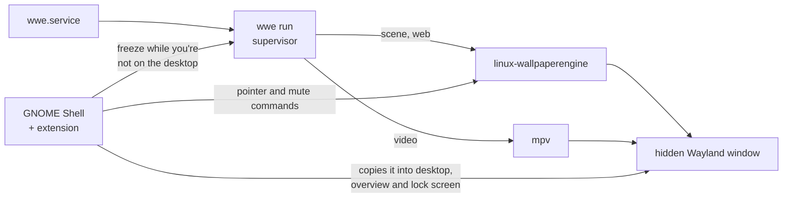

Full write-up: [docs/ARCHITECTURE.md](https://github.com/BhuwanJoshi-01/wayland-wallpaperengine/blob/main/docs/ARCHITECTURE.md)

</details>

<br>

<p align="center">
<a href="https://github.com/BhuwanJoshi-01/friday-whatsapp-ai-bot"></a>
<a href="https://github.com/BhuwanJoshi-01/UA-Hackathon-2026"></a>
<a href="https://github.com/BhuwanJoshi-01/MantraTracker">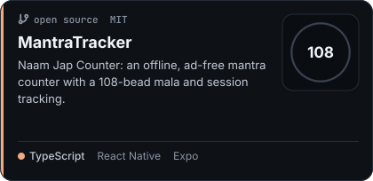</a>
<a href="https://github.com/BhuwanJoshi-01/Portfolio"></a>
</p>

<details>
<summary><b>Older repos</b></summary>

<br>

| Repo | What it is | Stack |
| :--- | :--- | :--- |
| [Smart_Refrigerator_Using_Arduino](https://github.com/BhuwanJoshi-01/Smart_Refrigerator_Using_Arduino) | Arduino code for a smart refrigerator, with a [Tinkercad build](https://www.tinkercad.com/things/j1lbvtGtLyl-smart-refriedgerator) | C++ |
| [DSA_Heart_Disease](https://github.com/BhuwanJoshi-01/DSA_Heart_Disease) | Heart-disease data notebook | Jupyter |
| [WEB_Project_Nature](https://github.com/BhuwanJoshi-01/WEB_Project_Nature) | Earthly Wonders, a nature site with six breakpoints | HTML, CSS |
| [Hospital-Management-System](https://github.com/BhuwanJoshi-01/Hospital-Management-System) | Admin, doctor and patient modules with a GUI | Python |

Early practice: [Python_Projects](https://github.com/BhuwanJoshi-01/Python_Projects), [Lamborghini_webpage](https://github.com/BhuwanJoshi-01/Lamborghini_webpage), [Gadgetic_Galaxy](https://github.com/BhuwanJoshi-01/Gadgetic_Galaxy), [Web_Elements](https://github.com/BhuwanJoshi-01/Web_Elements).

[Every public repo →](https://github.com/BhuwanJoshi-01?tab=repositories&type=public)

</details>

#### Going public next

Three small diagnostic CLIs I'm finishing up. Each one only looks and never touches: read-only by default, no network access, no telemetry.

<!-- When a repo goes public, wrap its image in a link to the repo. -->
<p align="center">

</p>

<a id="shipped"></a>

### `#` shipped

<p align="center">
<a href="https://setu.prateekinnovations.com">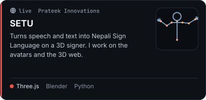</a>
<a href="https://aida.prateekinnovations.com"></a>
<a href="https://www.joshibhuwan.com.np/"></a>
<a href="https://www.joshibhuwan.com.np/"></a>
<a href="https://www.joshibhuwan.com.np/"></a>
<a href="https://www.joshibhuwan.com.np/"></a>
</p>

<details>
<summary><b>More work</b></summary>

<br>

| Project | What it does | Stack |
| :--- | :--- | :--- |
| Nepali Sign Language pipeline | Turns monocular sign-language video into rigged 3D avatars by fusing three pretrained vision models, with a recognition model going the other way | PyTorch, 3D pose estimation |
| Autonomous content pipeline | Unattended daily video: an LLM plans it, code renders it frame by frame, FFmpeg assembles it, systemd schedules it | FFmpeg, systemd, neural TTS |
| Real-time video calling | Self-built WebRTC SFU for multi-party calls with recording and chat | mediasoup, Socket.IO |
| [Forgex](https://forgexdev.me) | Learning and mentoring platform for developers | FastAPI, Django, WebRTC |
| [KodeSQL](https://kodesql.in) | Learn and solve SQL problems in the browser | Django, Monaco Editor |
| [Aagni Guard](https://agniniyantaran.com) | Billing, POS and inventory for a fire-safety business, with automatic refill reminders | Expo, Express, Prisma |
| 8 Eleven Hostel | Hostel management as an installable PWA with web push | Express, Prisma, Workbox |
| TimeFlow | Eisenhower matrix, Kanban, time blocking and Pomodoro in one app | React, Express, Firestore |

</details>

<a id="stack"></a>

### `#` stack

<picture>
  <source media="(max-width: 640px)" srcset="./assets/stack-mobile.svg">
  
</picture>

<a id="activity"></a>

### `#` activity

<picture>
  <source media="(max-width: 640px)" srcset="https://raw.githubusercontent.com/BhuwanJoshi-01/BhuwanJoshi-01/cards/activity-mobile.svg">
  
</picture>


<a id="contact"></a>

### `#` contact

> [!TIP]
> Open to full-time and internship roles. The quickest way to reach me is email or LinkedIn.

<a href="mailto:bhuwanj766@gmail.com">
  <picture>
    <source media="(max-width: 640px)" srcset="./assets/message-mobile.svg">
    
  </picture>
</a>

<p>
<br>
<a href="https://www.joshibhuwan.com.np/"></a>
<a href="https://www.linkedin.com/in/bhuwanjoshi-np/"></a>
<a href="mailto:bhuwanj766@gmail.com"></a>
</p>

<details>
<summary><b>Rotate a mountain</b> <sub>a real 3D model, because Markdown can do that</sub></summary>

<br>

Drag to rotate. It's a low-poly summit written as ASCII STL right inside this README.

```stl
solid himalaya
facet normal 0.00 0.00 1.00
outer loop
vertex 0 0 0
vertex 7 0 0
vertex 7 7 0
endloop
endfacet
facet normal 0.00 0.00 1.00
outer loop
vertex 0 0 0
vertex 7 7 0
vertex 0 7 0
endloop
endfacet
facet normal 0.00 0.00 1.00
outer loop
vertex 0 7 0
vertex 7 7 0
vertex 7 14 0
endloop
endfacet
facet normal 0.00 0.00 1.00
outer loop
vertex 0 7 0
vertex 7 14 0
vertex 0 14 0
endloop
endfacet
facet normal 0.00 -0.07 1.00
outer loop
vertex 0 14 0
vertex 7 14 0
vertex 7 21 0.5
endloop
endfacet
facet normal -0.07 0.00 1.00
outer loop
vertex 0 14 0
vertex 7 21 0.5
vertex 0 21 0
endloop
endfacet
facet normal -0.05 -0.63 0.78
outer loop
vertex 0 21 0
vertex 7 21 0.5
vertex 7 28 6.2
endloop
endfacet
facet normal -0.66 0.00 0.75
outer loop
vertex 0 21 0
vertex 7 28 6.2
vertex 0 28 0
endloop
endfacet
facet normal -0.65 -0.19 0.74
outer loop
vertex 0 28 0
vertex 7 28 6.2
vertex 7 35 8
endloop
endfacet
facet normal -0.75 0.00 0.66
outer loop
vertex 0 28 0
vertex 7 35 8
vertex 0 35 0
endloop
endfacet
facet normal -0.75 -0.02 0.66
outer loop
vertex 0 35 0
vertex 7 35 8
vertex 7 42 8.2
endloop
endfacet
facet normal -0.76 0.00 0.65
outer loop
vertex 0 35 0
vertex 7 42 8.2
vertex 0 42 0
endloop
endfacet
facet normal -0.65 0.52 0.56
outer loop
vertex 0 42 0
vertex 7 42 8.2
vertex 7 49 1.7
endloop
endfacet
facet normal -0.24 0.00 0.97
outer loop
vertex 0 42 0
vertex 7 49 1.7
vertex 0 49 0
endloop
endfacet
facet normal -0.23 0.23 0.94
outer loop
vertex 0 49 0
vertex 7 49 1.7
vertex 7 56 0
endloop
endfacet
facet normal 0.00 0.00 1.00
outer loop
vertex 0 49 0
vertex 7 56 0
vertex 0 56 0
endloop
endfacet
facet normal 0.00 0.00 1.00
outer loop
vertex 0 56 0
vertex 7 56 0
vertex 7 63 0
endloop
endfacet
facet normal 0.00 0.00 1.00
outer loop
vertex 0 56 0
vertex 7 63 0
vertex 0 63 0
endloop
endfacet
facet normal 0.00 0.00 1.00
outer loop
vertex 0 63 0
vertex 7 63 0
vertex 7 70 0
endloop
endfacet
facet normal 0.00 0.00 1.00
outer loop
vertex 0 63 0
vertex 7 70 0
vertex 0 70 0
endloop
endfacet
facet normal 0.00 0.00 1.00
outer loop
vertex 7 0 0
vertex 14 0 0
vertex 14 7 0
endloop
endfacet
facet normal 0.00 0.00 1.00
outer loop
vertex 7 0 0
vertex 14 7 0
vertex 7 7 0
endloop
endfacet
facet normal 0.00 -0.55 0.83
outer loop
vertex 7 7 0
vertex 14 7 0
vertex 14 14 4.7
endloop
endfacet
facet normal -0.55 0.00 0.83
outer loop
vertex 7 7 0
vertex 14 14 4.7
vertex 7 14 0
endloop
endfacet
facet normal -0.40 -0.69 0.60
outer loop
vertex 7 14 0
vertex 14 14 4.7
vertex 14 21 12.7
endloop
endfacet
facet normal -0.87 -0.03 0.50
outer loop
vertex 7 14 0
vertex 14 21 12.7
vertex 7 21 0.5
endloop
endfacet
facet normal -0.84 -0.23 0.48
outer loop
vertex 7 21 0.5
vertex 14 21 12.7
vertex 14 28 16.1
endloop
endfacet
facet normal -0.74 -0.42 0.52
outer loop
vertex 7 21 0.5
vertex 14 28 16.1
vertex 7 28 6.2
endloop
endfacet
facet normal -0.79 -0.24 0.56
outer loop
vertex 7 28 6.2
vertex 14 28 16.1
vertex 14 35 19.1
endloop
endfacet
facet normal -0.84 -0.13 0.53
outer loop
vertex 7 28 6.2
vertex 14 35 19.1
vertex 7 35 8
endloop
endfacet
facet normal -0.85 -0.02 0.53
outer loop
vertex 7 35 8
vertex 14 35 19.1
vertex 14 42 19.4
endloop
endfacet
facet normal -0.85 -0.02 0.53
outer loop
vertex 7 35 8
vertex 14 42 19.4
vertex 7 42 8.2
endloop
endfacet
facet normal -0.73 0.50 0.46
outer loop
vertex 7 42 8.2
vertex 14 42 19.4
vertex 14 49 11.7
endloop
endfacet
facet normal -0.72 0.47 0.51
outer loop
vertex 7 42 8.2
vertex 14 49 11.7
vertex 7 49 1.7
endloop
endfacet
facet normal -0.74 0.43 0.52
outer loop
vertex 7 49 1.7
vertex 14 49 11.7
vertex 14 56 6
endloop
endfacet
facet normal -0.64 0.18 0.75
outer loop
vertex 7 49 1.7
vertex 14 56 6
vertex 7 56 0
endloop
endfacet
facet normal -0.54 0.54 0.64
outer loop
vertex 7 56 0
vertex 14 56 6
vertex 14 63 0
endloop
endfacet
facet normal 0.00 0.00 1.00
outer loop
vertex 7 56 0
vertex 14 63 0
vertex 7 63 0
endloop
endfacet
facet normal 0.00 0.00 1.00
outer loop
vertex 7 63 0
vertex 14 63 0
vertex 14 70 0
endloop
endfacet
facet normal 0.00 0.00 1.00
outer loop
vertex 7 63 0
vertex 14 70 0
vertex 7 70 0
endloop
endfacet
facet normal 0.00 -0.34 0.94
outer loop
vertex 14 0 0
vertex 21 0 0
vertex 21 7 2.5
endloop
endfacet
facet normal -0.34 0.00 0.94
outer loop
vertex 14 0 0
vertex 21 7 2.5
vertex 14 7 0
endloop
endfacet
facet normal -0.20 -0.81 0.55
outer loop
vertex 14 7 0
vertex 21 7 2.5
vertex 21 14 12.9
endloop
endfacet
facet normal -0.70 -0.40 0.60
outer loop
vertex 14 7 0
vertex 21 14 12.9
vertex 14 14 4.7
endloop
endfacet
facet normal -0.50 -0.75 0.43
outer loop
vertex 14 14 4.7
vertex 21 14 12.9
vertex 21 21 25.1
endloop
endfacet
facet normal -0.76 -0.49 0.43
outer loop
vertex 14 14 4.7
vertex 21 21 25.1
vertex 14 21 12.7
endloop
endfacet
facet normal -0.87 -0.11 0.49
outer loop
vertex 14 21 12.7
vertex 21 21 25.1
vertex 21 28 26.6
endloop
endfacet
facet normal -0.80 -0.26 0.53
outer loop
vertex 14 21 12.7
vertex 21 28 26.6
vertex 14 28 16.1
endloop
endfacet
facet normal -0.73 -0.47 0.49
outer loop
vertex 14 28 16.1
vertex 21 28 26.6
vertex 21 35 33.4
endloop
endfacet
facet normal -0.88 -0.19 0.43
outer loop
vertex 14 28 16.1
vertex 21 35 33.4
vertex 14 35 19.1
endloop
endfacet
facet normal -0.90 0.05 0.44
outer loop
vertex 14 35 19.1
vertex 21 35 33.4
vertex 21 42 32.7
endloop
endfacet
facet normal -0.88 -0.02 0.47
outer loop
vertex 14 35 19.1
vertex 21 42 32.7
vertex 14 42 19.4
endloop
endfacet
facet normal -0.69 0.62 0.37
outer loop
vertex 14 42 19.4
vertex 21 42 32.7
vertex 21 49 20.9
endloop
endfacet
facet normal -0.66 0.56 0.51
outer loop
vertex 14 42 19.4
vertex 21 49 20.9
vertex 14 49 11.7
endloop
endfacet
facet normal -0.59 0.67 0.45
outer loop
vertex 14 49 11.7
vertex 21 49 20.9
vertex 21 56 10.3
endloop
endfacet
facet normal -0.43 0.57 0.70
outer loop
vertex 14 49 11.7
vertex 21 56 10.3
vertex 14 56 6
endloop
endfacet
facet normal -0.42 0.61 0.67
outer loop
vertex 14 56 6
vertex 21 56 10.3
vertex 21 63 3.9
endloop
endfacet
facet normal -0.39 0.60 0.70
outer loop
vertex 14 56 6
vertex 21 63 3.9
vertex 14 63 0
endloop
endfacet
facet normal -0.44 0.44 0.78
outer loop
vertex 14 63 0
vertex 21 63 3.9
vertex 21 70 0
endloop
endfacet
facet normal 0.00 0.00 1.00
outer loop
vertex 14 63 0
vertex 21 70 0
vertex 14 70 0
endloop
endfacet
facet normal 0.00 -0.77 0.64
outer loop
vertex 21 0 0
vertex 28 0 0
vertex 28 7 8.5
endloop
endfacet
facet normal -0.63 -0.26 0.73
outer loop
vertex 21 0 0
vertex 28 7 8.5
vertex 21 7 2.5
endloop
endfacet
facet normal -0.45 -0.73 0.52
outer loop
vertex 21 7 2.5
vertex 28 7 8.5
vertex 28 14 18.2
endloop
endfacet
facet normal -0.39 -0.76 0.51
outer loop
vertex 21 7 2.5
vertex 28 14 18.2
vertex 21 14 12.9
endloop
endfacet
facet normal -0.30 -0.87 0.39
outer loop
vertex 21 14 12.9
vertex 28 14 18.2
vertex 28 21 33.8
endloop
endfacet
facet normal -0.52 -0.74 0.42
outer loop
vertex 21 14 12.9
vertex 28 21 33.8
vertex 21 21 25.1
endloop
endfacet
facet normal -0.61 -0.61 0.50
outer loop
vertex 21 21 25.1
vertex 28 21 33.8
vertex 28 28 42.4
endloop
endfacet
facet normal -0.91 -0.09 0.40
outer loop
vertex 21 21 25.1
vertex 28 28 42.4
vertex 21 28 26.6
endloop
endfacet
facet normal -0.85 -0.37 0.38
outer loop
vertex 21 28 26.6
vertex 28 28 42.4
vertex 28 35 49.3
endloop
endfacet
facet normal -0.85 -0.36 0.37
outer loop
vertex 21 28 26.6
vertex 28 35 49.3
vertex 21 35 33.4
endloop
endfacet
facet normal -0.75 0.58 0.33
outer loop
vertex 21 35 33.4
vertex 28 35 49.3
vertex 28 42 37.1
endloop
endfacet
facet normal -0.53 0.09 0.84
outer loop
vertex 21 35 33.4
vertex 28 42 37.1
vertex 21 42 32.7
endloop
endfacet
facet normal -0.39 0.69 0.61
outer loop
vertex 21 42 32.7
vertex 28 42 37.1
vertex 28 49 29.2
endloop
endfacet
facet normal -0.52 0.74 0.44
outer loop
vertex 21 42 32.7
vertex 28 49 29.2
vertex 21 49 20.9
endloop
endfacet
facet normal -0.63 0.57 0.53
outer loop
vertex 21 49 20.9
vertex 28 49 29.2
vertex 28 56 21.7
endloop
endfacet
facet normal -0.67 0.62 0.41
outer loop
vertex 21 49 20.9
vertex 28 56 21.7
vertex 21 56 10.3
endloop
endfacet
facet normal -0.59 0.72 0.36
outer loop
vertex 21 56 10.3
vertex 28 56 21.7
vertex 28 63 7.8
endloop
endfacet
facet normal -0.38 0.63 0.68
outer loop
vertex 21 56 10.3
vertex 28 63 7.8
vertex 21 63 3.9
endloop
endfacet
facet normal -0.35 0.70 0.63
outer loop
vertex 21 63 3.9
vertex 28 63 7.8
vertex 28 70 0
endloop
endfacet
facet normal 0.00 0.49 0.87
outer loop
vertex 21 63 3.9
vertex 28 70 0
vertex 21 70 0
endloop
endfacet
facet normal 0.00 -0.82 0.57
outer loop
vertex 28 0 0
vertex 35 0 0
vertex 35 7 10.2
endloop
endfacet
facet normal -0.15 -0.76 0.63
outer loop
vertex 28 0 0
vertex 35 7 10.2
vertex 28 7 8.5
endloop
endfacet
facet normal -0.15 -0.76 0.63
outer loop
vertex 28 7 8.5
vertex 35 7 10.2
vertex 35 14 18.7
endloop
endfacet
facet normal -0.04 -0.81 0.58
outer loop
vertex 28 7 8.5
vertex 35 14 18.7
vertex 28 14 18.2
endloop
endfacet
facet normal -0.03 -0.88 0.47
outer loop
vertex 28 14 18.2
vertex 35 14 18.7
vertex 35 21 31.9
endloop
endfacet
facet normal 0.11 -0.91 0.41
outer loop
vertex 28 14 18.2
vertex 35 21 31.9
vertex 28 21 33.8
endloop
endfacet
facet normal 0.12 -0.90 0.43
outer loop
vertex 28 21 33.8
vertex 35 21 31.9
vertex 35 28 46.5
endloop
endfacet
facet normal -0.34 -0.73 0.59
outer loop
vertex 28 21 33.8
vertex 35 28 46.5
vertex 28 28 42.4
endloop
endfacet
facet normal -0.10 -0.98 0.18
outer loop
vertex 28 28 42.4
vertex 35 28 46.5
vertex 35 35 85.5
endloop
endfacet
facet normal -0.96 -0.18 0.19
outer loop
vertex 28 28 42.4
vertex 35 35 85.5
vertex 28 35 49.3
endloop
endfacet
facet normal -0.71 0.69 0.14
outer loop
vertex 28 35 49.3
vertex 35 35 85.5
vertex 35 42 50.6
endloop
endfacet
facet normal -0.69 0.63 0.36
outer loop
vertex 28 35 49.3
vertex 35 42 50.6
vertex 28 42 37.1
endloop
endfacet
facet normal -0.67 0.66 0.35
outer loop
vertex 28 42 37.1
vertex 35 42 50.6
vertex 35 49 37.3
endloop
endfacet
facet normal -0.61 0.59 0.53
outer loop
vertex 28 42 37.1
vertex 35 49 37.3
vertex 28 49 29.2
endloop
endfacet
facet normal -0.46 0.79 0.40
outer loop
vertex 28 49 29.2
vertex 35 49 37.3
vertex 35 56 23.3
endloop
endfacet
facet normal -0.16 0.72 0.67
outer loop
vertex 28 49 29.2
vertex 35 56 23.3
vertex 28 56 21.7
endloop
endfacet
facet normal -0.10 0.90 0.43
outer loop
vertex 28 56 21.7
vertex 35 56 23.3
vertex 35 63 8.5
endloop
endfacet
facet normal -0.05 0.89 0.45
outer loop
vertex 28 56 21.7
vertex 35 63 8.5
vertex 28 63 7.8
endloop
endfacet
facet normal -0.07 0.77 0.63
outer loop
vertex 28 63 7.8
vertex 35 63 8.5
vertex 35 70 0
endloop
endfacet
facet normal 0.00 0.74 0.67
outer loop
vertex 28 63 7.8
vertex 35 70 0
vertex 28 70 0
endloop
endfacet
facet normal 0.00 -0.61 0.79
outer loop
vertex 35 0 0
vertex 42 0 0
vertex 42 7 5.4
endloop
endfacet
facet normal 0.36 -0.77 0.53
outer loop
vertex 35 0 0
vertex 42 7 5.4
vertex 35 7 10.2
endloop
endfacet
facet normal 0.28 -0.87 0.41
outer loop
vertex 35 7 10.2
vertex 42 7 5.4
vertex 42 14 20.2
endloop
endfacet
facet normal -0.13 -0.77 0.63
outer loop
vertex 35 7 10.2
vertex 42 14 20.2
vertex 35 14 18.7
endloop
endfacet
facet normal -0.11 -0.86 0.50
outer loop
vertex 35 14 18.7
vertex 42 14 20.2
vertex 42 21 32.2
endloop
endfacet
facet normal -0.02 -0.88 0.47
outer loop
vertex 35 14 18.7
vertex 42 21 32.2
vertex 35 21 31.9
endloop
endfacet
facet normal -0.03 -0.86 0.51
outer loop
vertex 35 21 31.9
vertex 42 21 32.2
vertex 42 28 43.9
endloop
endfacet
facet normal 0.16 -0.89 0.43
outer loop
vertex 35 21 31.9
vertex 42 28 43.9
vertex 35 28 46.5
endloop
endfacet
facet normal 0.31 -0.43 0.85
outer loop
vertex 35 28 46.5
vertex 42 28 43.9
vertex 42 35 47.4
endloop
endfacet
facet normal 0.69 -0.71 0.13
outer loop
vertex 35 28 46.5
vertex 42 35 47.4
vertex 35 35 85.5
endloop
endfacet
facet normal 0.97 0.18 0.18
outer loop
vertex 35 35 85.5
vertex 42 35 47.4
vertex 42 42 40.5
endloop
endfacet
facet normal 0.27 0.94 0.19
outer loop
vertex 35 35 85.5
vertex 42 42 40.5
vertex 35 42 50.6
endloop
endfacet
facet normal 0.62 0.66 0.43
outer loop
vertex 35 42 50.6
vertex 42 42 40.5
vertex 42 49 29.6
endloop
endfacet
facet normal 0.46 0.79 0.42
outer loop
vertex 35 42 50.6
vertex 42 49 29.6
vertex 35 49 37.3
endloop
endfacet
facet normal 0.51 0.73 0.46
outer loop
vertex 35 49 37.3
vertex 42 49 29.6
vertex 42 56 18.5
endloop
endfacet
facet normal 0.29 0.86 0.43
outer loop
vertex 35 49 37.3
vertex 42 56 18.5
vertex 35 56 23.3
endloop
endfacet
facet normal 0.32 0.83 0.46
outer loop
vertex 35 56 23.3
vertex 42 56 18.5
vertex 42 63 6
endloop
endfacet
facet normal 0.15 0.89 0.42
outer loop
vertex 35 56 23.3
vertex 42 63 6
vertex 35 63 8.5
endloop
endfacet
facet normal 0.26 0.63 0.73
outer loop
vertex 35 63 8.5
vertex 42 63 6
vertex 42 70 0
endloop
endfacet
facet normal 0.00 0.77 0.63
outer loop
vertex 35 63 8.5
vertex 42 70 0
vertex 35 70 0
endloop
endfacet
facet normal 0.00 -0.61 0.79
outer loop
vertex 42 0 0
vertex 49 0 0
vertex 49 7 5.4
endloop
endfacet
facet normal 0.01 -0.61 0.79
outer loop
vertex 42 0 0
vertex 49 7 5.4
vertex 42 7 5.4
endloop
endfacet
facet normal 0.01 -0.70 0.72
outer loop
vertex 42 7 5.4
vertex 49 7 5.4
vertex 49 14 12.2
endloop
endfacet
facet normal 0.44 -0.81 0.38
outer loop
vertex 42 7 5.4
vertex 49 14 12.2
vertex 42 14 20.2
endloop
endfacet
facet normal 0.53 -0.72 0.46
outer loop
vertex 42 14 20.2
vertex 49 14 12.2
vertex 49 21 23.1
endloop
endfacet
facet normal 0.55 -0.72 0.42
outer loop
vertex 42 14 20.2
vertex 49 21 23.1
vertex 42 21 32.2
endloop
endfacet
facet normal 0.74 -0.35 0.57
outer loop
vertex 42 21 32.2
vertex 49 21 23.1
vertex 49 28 27.3
endloop
endfacet
facet normal 0.77 -0.54 0.33
outer loop
vertex 42 21 32.2
vertex 49 28 27.3
vertex 42 28 43.9
endloop
endfacet
facet normal 0.87 -0.33 0.37
outer loop
vertex 42 28 43.9
vertex 49 28 27.3
vertex 49 35 33.7
endloop
endfacet
facet normal 0.87 -0.22 0.44
outer loop
vertex 42 28 43.9
vertex 49 35 33.7
vertex 42 35 47.4
endloop
endfacet
facet normal 0.87 0.20 0.44
outer loop
vertex 42 35 47.4
vertex 49 35 33.7
vertex 49 42 30.5
endloop
endfacet
facet normal 0.71 0.50 0.50
outer loop
vertex 42 35 47.4
vertex 49 42 30.5
vertex 42 42 40.5
endloop
endfacet
facet normal 0.67 0.57 0.47
outer loop
vertex 42 42 40.5
vertex 49 42 30.5
vertex 49 49 22.1
endloop
endfacet
facet normal 0.51 0.72 0.47
outer loop
vertex 42 42 40.5
vertex 49 49 22.1
vertex 42 49 29.6
endloop
endfacet
facet normal 0.47 0.77 0.43
outer loop
vertex 42 49 29.6
vertex 49 49 22.1
vertex 49 56 9.5
endloop
endfacet
facet normal 0.56 0.70 0.44
outer loop
vertex 42 49 29.6
vertex 49 56 9.5
vertex 42 56 18.5
endloop
endfacet
facet normal 0.69 0.48 0.54
outer loop
vertex 42 56 18.5
vertex 49 56 9.5
vertex 49 63 3.2
endloop
endfacet
facet normal 0.19 0.86 0.48
outer loop
vertex 42 56 18.5
vertex 49 63 3.2
vertex 42 63 6
endloop
endfacet
facet normal 0.34 0.39 0.85
outer loop
vertex 42 63 6
vertex 49 63 3.2
vertex 49 70 0
endloop
endfacet
facet normal 0.00 0.65 0.76
outer loop
vertex 42 63 6
vertex 49 70 0
vertex 42 70 0
endloop
endfacet
facet normal 0.00 0.00 1.00
outer loop
vertex 49 0 0
vertex 56 0 0
vertex 56 7 0
endloop
endfacet
facet normal 0.52 -0.52 0.68
outer loop
vertex 49 0 0
vertex 56 7 0
vertex 49 7 5.4
endloop
endfacet
facet normal 0.48 -0.61 0.63
outer loop
vertex 49 7 5.4
vertex 56 7 0
vertex 56 14 6.7
endloop
endfacet
facet normal 0.49 -0.61 0.63
outer loop
vertex 49 7 5.4
vertex 56 14 6.7
vertex 49 14 12.2
endloop
endfacet
facet normal 0.51 -0.56 0.66
outer loop
vertex 49 14 12.2
vertex 56 14 6.7
vertex 56 21 12.7
endloop
endfacet
facet normal 0.63 -0.66 0.42
outer loop
vertex 49 14 12.2
vertex 56 21 12.7
vertex 49 21 23.1
endloop
endfacet
facet normal 0.81 -0.21 0.55
outer loop
vertex 49 21 23.1
vertex 56 21 12.7
vertex 56 28 15.4
endloop
endfacet
facet normal 0.83 -0.29 0.48
outer loop
vertex 49 21 23.1
vertex 56 28 15.4
vertex 49 28 27.3
endloop
endfacet
facet normal 0.84 -0.24 0.49
outer loop
vertex 49 28 27.3
vertex 56 28 15.4
vertex 56 35 18.8
endloop
endfacet
facet normal 0.84 -0.36 0.40
outer loop
vertex 49 28 27.3
vertex 56 35 18.8
vertex 49 35 33.7
endloop
endfacet
facet normal 0.90 0.03 0.43
outer loop
vertex 49 35 33.7
vertex 56 35 18.8
vertex 56 42 18.4
endloop
endfacet
facet normal 0.84 0.22 0.49
outer loop
vertex 49 35 33.7
vertex 56 42 18.4
vertex 49 42 30.5
endloop
endfacet
facet normal 0.81 0.34 0.47
outer loop
vertex 49 42 30.5
vertex 56 42 18.4
vertex 56 49 13.3
endloop
endfacet
facet normal 0.63 0.60 0.50
outer loop
vertex 49 42 30.5
vertex 56 49 13.3
vertex 49 49 22.1
endloop
endfacet
facet normal 0.59 0.66 0.47
outer loop
vertex 49 49 22.1
vertex 56 49 13.3
vertex 56 56 3.5
endloop
endfacet
facet normal 0.38 0.81 0.45
outer loop
vertex 49 49 22.1
vertex 56 56 3.5
vertex 49 56 9.5
endloop
endfacet
facet normal 0.61 0.36 0.71
outer loop
vertex 49 56 9.5
vertex 56 56 3.5
vertex 56 63 0
endloop
endfacet
facet normal 0.33 0.63 0.71
outer loop
vertex 49 56 9.5
vertex 56 63 0
vertex 49 63 3.2
endloop
endfacet
facet normal 0.42 0.00 0.91
outer loop
vertex 49 63 3.2
vertex 56 63 0
vertex 56 70 0
endloop
endfacet
facet normal 0.00 0.42 0.91
outer loop
vertex 49 63 3.2
vertex 56 70 0
vertex 49 70 0
endloop
endfacet
facet normal 0.00 0.00 1.00
outer loop
vertex 56 0 0
vertex 63 0 0
vertex 63 7 0
endloop
endfacet
facet normal 0.00 0.00 1.00
outer loop
vertex 56 0 0
vertex 63 7 0
vertex 56 7 0
endloop
endfacet
facet normal 0.00 0.00 1.00
outer loop
vertex 56 7 0
vertex 63 7 0
vertex 63 14 0
endloop
endfacet
facet normal 0.57 -0.57 0.59
outer loop
vertex 56 7 0
vertex 63 14 0
vertex 56 14 6.7
endloop
endfacet
facet normal 0.67 -0.24 0.70
outer loop
vertex 56 14 6.7
vertex 63 14 0
vertex 63 21 2.4
endloop
endfacet
facet normal 0.75 -0.43 0.51
outer loop
vertex 56 14 6.7
vertex 63 21 2.4
vertex 56 21 12.7
endloop
endfacet
facet normal 0.82 -0.10 0.56
outer loop
vertex 56 21 12.7
vertex 63 21 2.4
vertex 63 28 3.6
endloop
endfacet
facet normal 0.84 -0.19 0.50
outer loop
vertex 56 21 12.7
vertex 63 28 3.6
vertex 56 28 15.4
endloop
endfacet
facet normal 0.81 -0.33 0.48
outer loop
vertex 56 28 15.4
vertex 63 28 3.6
vertex 63 35 8.4
endloop
endfacet
facet normal 0.80 -0.27 0.54
outer loop
vertex 56 28 15.4
vertex 63 35 8.4
vertex 56 35 18.8
endloop
endfacet
facet normal 0.83 0.02 0.56
outer loop
vertex 56 35 18.8
vertex 63 35 8.4
vertex 63 42 8.1
endloop
endfacet
facet normal 0.82 0.04 0.56
outer loop
vertex 56 35 18.8
vertex 63 42 8.1
vertex 56 42 18.4
endloop
endfacet
facet normal 0.71 0.50 0.49
outer loop
vertex 56 42 18.4
vertex 63 42 8.1
vertex 63 49 1
endloop
endfacet
facet normal 0.82 0.34 0.46
outer loop
vertex 56 42 18.4
vertex 63 49 1
vertex 56 49 13.3
endloop
endfacet
facet normal 0.87 0.07 0.49
outer loop
vertex 56 49 13.3
vertex 63 49 1
vertex 63 56 0
endloop
endfacet
facet normal 0.28 0.78 0.56
outer loop
vertex 56 49 13.3
vertex 63 56 0
vertex 56 56 3.5
endloop
endfacet
facet normal 0.45 0.00 0.89
outer loop
vertex 56 56 3.5
vertex 63 56 0
vertex 63 63 0
endloop
endfacet
facet normal 0.00 0.45 0.89
outer loop
vertex 56 56 3.5
vertex 63 63 0
vertex 56 63 0
endloop
endfacet
facet normal 0.00 0.00 1.00
outer loop
vertex 56 63 0
vertex 63 63 0
vertex 63 70 0
endloop
endfacet
facet normal 0.00 0.00 1.00
outer loop
vertex 56 63 0
vertex 63 70 0
vertex 56 70 0
endloop
endfacet
facet normal 0.00 0.00 1.00
outer loop
vertex 63 0 0
vertex 70 0 0
vertex 70 7 0
endloop
endfacet
facet normal 0.00 0.00 1.00
outer loop
vertex 63 0 0
vertex 70 7 0
vertex 63 7 0
endloop
endfacet
facet normal 0.00 0.00 1.00
outer loop
vertex 63 7 0
vertex 70 7 0
vertex 70 14 0
endloop
endfacet
facet normal 0.00 0.00 1.00
outer loop
vertex 63 7 0
vertex 70 14 0
vertex 63 14 0
endloop
endfacet
facet normal 0.00 0.00 1.00
outer loop
vertex 63 14 0
vertex 70 14 0
vertex 70 21 0
endloop
endfacet
facet normal 0.30 -0.30 0.90
outer loop
vertex 63 14 0
vertex 70 21 0
vertex 63 21 2.4
endloop
endfacet
facet normal 0.32 0.00 0.95
outer loop
vertex 63 21 2.4
vertex 70 21 0
vertex 70 28 0
endloop
endfacet
facet normal 0.45 -0.16 0.88
outer loop
vertex 63 21 2.4
vertex 70 28 0
vertex 63 28 3.6
endloop
endfacet
facet normal 0.46 0.00 0.89
outer loop
vertex 63 28 3.6
vertex 70 28 0
vertex 70 35 0
endloop
endfacet
facet normal 0.70 -0.40 0.59
outer loop
vertex 63 28 3.6
vertex 70 35 0
vertex 63 35 8.4
endloop
endfacet
facet normal 0.77 0.00 0.64
outer loop
vertex 63 35 8.4
vertex 70 35 0
vertex 70 42 0
endloop
endfacet
facet normal 0.76 0.03 0.65
outer loop
vertex 63 35 8.4
vertex 70 42 0
vertex 63 42 8.1
endloop
endfacet
facet normal 0.76 0.00 0.65
outer loop
vertex 63 42 8.1
vertex 70 42 0
vertex 70 49 0
endloop
endfacet
facet normal 0.09 0.71 0.70
outer loop
vertex 63 42 8.1
vertex 70 49 0
vertex 63 49 1
endloop
endfacet
facet normal 0.13 0.00 0.99
outer loop
vertex 63 49 1
vertex 70 49 0
vertex 70 56 0
endloop
endfacet
facet normal 0.00 0.13 0.99
outer loop
vertex 63 49 1
vertex 70 56 0
vertex 63 56 0
endloop
endfacet
facet normal 0.00 0.00 1.00
outer loop
vertex 63 56 0
vertex 70 56 0
vertex 70 63 0
endloop
endfacet
facet normal 0.00 0.00 1.00
outer loop
vertex 63 56 0
vertex 70 63 0
vertex 63 63 0
endloop
endfacet
facet normal 0.00 0.00 1.00
outer loop
vertex 63 63 0
vertex 70 63 0
vertex 70 70 0
endloop
endfacet
facet normal 0.00 0.00 1.00
outer loop
vertex 63 63 0
vertex 70 70 0
vertex 63 70 0
endloop
endfacet
facet normal 0.00 -1.00 0.00
outer loop
vertex 0 0 -6
vertex 7 0 -6
vertex 7 0 0
endloop
endfacet
facet normal 0.00 -1.00 0.00
outer loop
vertex 0 0 -6
vertex 7 0 0
vertex 0 0 0
endloop
endfacet
facet normal 0.00 1.00 0.00
outer loop
vertex 7 70 -6
vertex 0 70 -6
vertex 0 70 0
endloop
endfacet
facet normal 0.00 1.00 -0.00
outer loop
vertex 7 70 -6
vertex 0 70 0
vertex 7 70 0
endloop
endfacet
facet normal -1.00 0.00 0.00
outer loop
vertex 0 7 -6
vertex 0 0 -6
vertex 0 0 0
endloop
endfacet
facet normal -1.00 0.00 0.00
outer loop
vertex 0 7 -6
vertex 0 0 0
vertex 0 7 0
endloop
endfacet
facet normal 1.00 0.00 0.00
outer loop
vertex 70 0 -6
vertex 70 7 -6
vertex 70 7 0
endloop
endfacet
facet normal 1.00 0.00 0.00
outer loop
vertex 70 0 -6
vertex 70 7 0
vertex 70 0 0
endloop
endfacet
facet normal 0.00 -1.00 0.00
outer loop
vertex 7 0 -6
vertex 14 0 -6
vertex 14 0 0
endloop
endfacet
facet normal 0.00 -1.00 0.00
outer loop
vertex 7 0 -6
vertex 14 0 0
vertex 7 0 0
endloop
endfacet
facet normal 0.00 1.00 0.00
outer loop
vertex 14 70 -6
vertex 7 70 -6
vertex 7 70 0
endloop
endfacet
facet normal 0.00 1.00 -0.00
outer loop
vertex 14 70 -6
vertex 7 70 0
vertex 14 70 0
endloop
endfacet
facet normal -1.00 0.00 0.00
outer loop
vertex 0 14 -6
vertex 0 7 -6
vertex 0 7 0
endloop
endfacet
facet normal -1.00 0.00 0.00
outer loop
vertex 0 14 -6
vertex 0 7 0
vertex 0 14 0
endloop
endfacet
facet normal 1.00 0.00 0.00
outer loop
vertex 70 7 -6
vertex 70 14 -6
vertex 70 14 0
endloop
endfacet
facet normal 1.00 0.00 0.00
outer loop
vertex 70 7 -6
vertex 70 14 0
vertex 70 7 0
endloop
endfacet
facet normal 0.00 -1.00 0.00
outer loop
vertex 14 0 -6
vertex 21 0 -6
vertex 21 0 0
endloop
endfacet
facet normal 0.00 -1.00 0.00
outer loop
vertex 14 0 -6
vertex 21 0 0
vertex 14 0 0
endloop
endfacet
facet normal 0.00 1.00 0.00
outer loop
vertex 21 70 -6
vertex 14 70 -6
vertex 14 70 0
endloop
endfacet
facet normal 0.00 1.00 -0.00
outer loop
vertex 21 70 -6
vertex 14 70 0
vertex 21 70 0
endloop
endfacet
facet normal -1.00 0.00 0.00
outer loop
vertex 0 21 -6
vertex 0 14 -6
vertex 0 14 0
endloop
endfacet
facet normal -1.00 0.00 0.00
outer loop
vertex 0 21 -6
vertex 0 14 0
vertex 0 21 0
endloop
endfacet
facet normal 1.00 0.00 0.00
outer loop
vertex 70 14 -6
vertex 70 21 -6
vertex 70 21 0
endloop
endfacet
facet normal 1.00 0.00 0.00
outer loop
vertex 70 14 -6
vertex 70 21 0
vertex 70 14 0
endloop
endfacet
facet normal 0.00 -1.00 0.00
outer loop
vertex 21 0 -6
vertex 28 0 -6
vertex 28 0 0
endloop
endfacet
facet normal 0.00 -1.00 0.00
outer loop
vertex 21 0 -6
vertex 28 0 0
vertex 21 0 0
endloop
endfacet
facet normal 0.00 1.00 0.00
outer loop
vertex 28 70 -6
vertex 21 70 -6
vertex 21 70 0
endloop
endfacet
facet normal 0.00 1.00 -0.00
outer loop
vertex 28 70 -6
vertex 21 70 0
vertex 28 70 0
endloop
endfacet
facet normal -1.00 0.00 0.00
outer loop
vertex 0 28 -6
vertex 0 21 -6
vertex 0 21 0
endloop
endfacet
facet normal -1.00 0.00 0.00
outer loop
vertex 0 28 -6
vertex 0 21 0
vertex 0 28 0
endloop
endfacet
facet normal 1.00 0.00 0.00
outer loop
vertex 70 21 -6
vertex 70 28 -6
vertex 70 28 0
endloop
endfacet
facet normal 1.00 0.00 0.00
outer loop
vertex 70 21 -6
vertex 70 28 0
vertex 70 21 0
endloop
endfacet
facet normal 0.00 -1.00 0.00
outer loop
vertex 28 0 -6
vertex 35 0 -6
vertex 35 0 0
endloop
endfacet
facet normal 0.00 -1.00 0.00
outer loop
vertex 28 0 -6
vertex 35 0 0
vertex 28 0 0
endloop
endfacet
facet normal 0.00 1.00 0.00
outer loop
vertex 35 70 -6
vertex 28 70 -6
vertex 28 70 0
endloop
endfacet
facet normal 0.00 1.00 -0.00
outer loop
vertex 35 70 -6
vertex 28 70 0
vertex 35 70 0
endloop
endfacet
facet normal -1.00 0.00 0.00
outer loop
vertex 0 35 -6
vertex 0 28 -6
vertex 0 28 0
endloop
endfacet
facet normal -1.00 0.00 0.00
outer loop
vertex 0 35 -6
vertex 0 28 0
vertex 0 35 0
endloop
endfacet
facet normal 1.00 0.00 0.00
outer loop
vertex 70 28 -6
vertex 70 35 -6
vertex 70 35 0
endloop
endfacet
facet normal 1.00 0.00 0.00
outer loop
vertex 70 28 -6
vertex 70 35 0
vertex 70 28 0
endloop
endfacet
facet normal 0.00 -1.00 0.00
outer loop
vertex 35 0 -6
vertex 42 0 -6
vertex 42 0 0
endloop
endfacet
facet normal 0.00 -1.00 0.00
outer loop
vertex 35 0 -6
vertex 42 0 0
vertex 35 0 0
endloop
endfacet
facet normal 0.00 1.00 0.00
outer loop
vertex 42 70 -6
vertex 35 70 -6
vertex 35 70 0
endloop
endfacet
facet normal 0.00 1.00 -0.00
outer loop
vertex 42 70 -6
vertex 35 70 0
vertex 42 70 0
endloop
endfacet
facet normal -1.00 0.00 0.00
outer loop
vertex 0 42 -6
vertex 0 35 -6
vertex 0 35 0
endloop
endfacet
facet normal -1.00 0.00 0.00
outer loop
vertex 0 42 -6
vertex 0 35 0
vertex 0 42 0
endloop
endfacet
facet normal 1.00 0.00 0.00
outer loop
vertex 70 35 -6
vertex 70 42 -6
vertex 70 42 0
endloop
endfacet
facet normal 1.00 0.00 0.00
outer loop
vertex 70 35 -6
vertex 70 42 0
vertex 70 35 0
endloop
endfacet
facet normal 0.00 -1.00 0.00
outer loop
vertex 42 0 -6
vertex 49 0 -6
vertex 49 0 0
endloop
endfacet
facet normal 0.00 -1.00 0.00
outer loop
vertex 42 0 -6
vertex 49 0 0
vertex 42 0 0
endloop
endfacet
facet normal 0.00 1.00 0.00
outer loop
vertex 49 70 -6
vertex 42 70 -6
vertex 42 70 0
endloop
endfacet
facet normal 0.00 1.00 -0.00
outer loop
vertex 49 70 -6
vertex 42 70 0
vertex 49 70 0
endloop
endfacet
facet normal -1.00 0.00 0.00
outer loop
vertex 0 49 -6
vertex 0 42 -6
vertex 0 42 0
endloop
endfacet
facet normal -1.00 0.00 0.00
outer loop
vertex 0 49 -6
vertex 0 42 0
vertex 0 49 0
endloop
endfacet
facet normal 1.00 0.00 0.00
outer loop
vertex 70 42 -6
vertex 70 49 -6
vertex 70 49 0
endloop
endfacet
facet normal 1.00 0.00 0.00
outer loop
vertex 70 42 -6
vertex 70 49 0
vertex 70 42 0
endloop
endfacet
facet normal 0.00 -1.00 0.00
outer loop
vertex 49 0 -6
vertex 56 0 -6
vertex 56 0 0
endloop
endfacet
facet normal 0.00 -1.00 0.00
outer loop
vertex 49 0 -6
vertex 56 0 0
vertex 49 0 0
endloop
endfacet
facet normal 0.00 1.00 0.00
outer loop
vertex 56 70 -6
vertex 49 70 -6
vertex 49 70 0
endloop
endfacet
facet normal 0.00 1.00 -0.00
outer loop
vertex 56 70 -6
vertex 49 70 0
vertex 56 70 0
endloop
endfacet
facet normal -1.00 0.00 0.00
outer loop
vertex 0 56 -6
vertex 0 49 -6
vertex 0 49 0
endloop
endfacet
facet normal -1.00 0.00 0.00
outer loop
vertex 0 56 -6
vertex 0 49 0
vertex 0 56 0
endloop
endfacet
facet normal 1.00 0.00 0.00
outer loop
vertex 70 49 -6
vertex 70 56 -6
vertex 70 56 0
endloop
endfacet
facet normal 1.00 0.00 0.00
outer loop
vertex 70 49 -6
vertex 70 56 0
vertex 70 49 0
endloop
endfacet
facet normal 0.00 -1.00 0.00
outer loop
vertex 56 0 -6
vertex 63 0 -6
vertex 63 0 0
endloop
endfacet
facet normal 0.00 -1.00 0.00
outer loop
vertex 56 0 -6
vertex 63 0 0
vertex 56 0 0
endloop
endfacet
facet normal 0.00 1.00 0.00
outer loop
vertex 63 70 -6
vertex 56 70 -6
vertex 56 70 0
endloop
endfacet
facet normal 0.00 1.00 -0.00
outer loop
vertex 63 70 -6
vertex 56 70 0
vertex 63 70 0
endloop
endfacet
facet normal -1.00 0.00 0.00
outer loop
vertex 0 63 -6
vertex 0 56 -6
vertex 0 56 0
endloop
endfacet
facet normal -1.00 0.00 0.00
outer loop
vertex 0 63 -6
vertex 0 56 0
vertex 0 63 0
endloop
endfacet
facet normal 1.00 0.00 0.00
outer loop
vertex 70 56 -6
vertex 70 63 -6
vertex 70 63 0
endloop
endfacet
facet normal 1.00 0.00 0.00
outer loop
vertex 70 56 -6
vertex 70 63 0
vertex 70 56 0
endloop
endfacet
facet normal 0.00 -1.00 0.00
outer loop
vertex 63 0 -6
vertex 70 0 -6
vertex 70 0 0
endloop
endfacet
facet normal 0.00 -1.00 0.00
outer loop
vertex 63 0 -6
vertex 70 0 0
vertex 63 0 0
endloop
endfacet
facet normal 0.00 1.00 0.00
outer loop
vertex 70 70 -6
vertex 63 70 -6
vertex 63 70 0
endloop
endfacet
facet normal 0.00 1.00 -0.00
outer loop
vertex 70 70 -6
vertex 63 70 0
vertex 70 70 0
endloop
endfacet
facet normal -1.00 0.00 0.00
outer loop
vertex 0 70 -6
vertex 0 63 -6
vertex 0 63 0
endloop
endfacet
facet normal -1.00 0.00 0.00
outer loop
vertex 0 70 -6
vertex 0 63 0
vertex 0 70 0
endloop
endfacet
facet normal 1.00 0.00 0.00
outer loop
vertex 70 63 -6
vertex 70 70 -6
vertex 70 70 0
endloop
endfacet
facet normal 1.00 0.00 0.00
outer loop
vertex 70 63 -6
vertex 70 70 0
vertex 70 63 0
endloop
endfacet
facet normal 0.00 0.00 -1.00
outer loop
vertex 0 0 -6
vertex 0 70 -6
vertex 70 70 -6
endloop
endfacet
facet normal 0.00 0.00 -1.00
outer loop
vertex 0 0 -6
vertex 70 70 -6
vertex 70 0 -6
endloop
endfacet
endsolid himalaya
```

</details>

<details>
<summary><b>How this README works</b></summary>

<br>

No JavaScript and no third-party card services. Each card is an SVG that animates with CSS, because that's what GitHub lets through an `` tag.

- **Text is outlined.** Fonts are shaped with HarfBuzz and written as glyph paths, so they look the same everywhere, Devanagari included.
- **It respects your settings.** With reduced motion turned on, every card holds still.
- **Phones get their own layouts,** chosen with `<picture>` and a media query.
- **The activity card rebuilds itself daily** from the GitHub API, through [a small Action](./.github/workflows/refresh.yml).
- **The stack colours are prayer flags:** blue, white, red, green and yellow.
- **Also native Markdown:** `<details>`, `<kbd>`, alerts, footnotes, a Mermaid diagram and an STL model.

Rebuild everything with `pip install -r scripts/requirements.txt && python scripts/build.py`.

</details>

[^1]: Measured on an Intel iGPU, comparing the desktop in focus with an app in focus: renderer CPU 13 % to 0 %, GNOME Shell CPU 22 % to 3 %, GPU 71 % to 7 %.
